<div align="center">


# Download Craft

**A fast, free download manager — with a browser extension that catches the videos other tools miss.**

Multi-connection downloads, a queue and scheduler, YouTube and 1,000+ sites through its own
yt-dlp, and an extension that works with the app — or on its own.

<a href="https://github.com/hungry-detective/downloadcraft/releases"></a>

[](https://github.com/hungry-detective/downloadcraft/releases/latest)
[](LICENSE)
[](https://www.rust-lang.org)

<br>

[](https://github.com/hungry-detective/downloadcraft/releases/download/v0.10.0/DownloadCraft-0.10.0-windows-x64-setup.exe)
&nbsp;
[](https://github.com/hungry-detective/downloadcraft/releases/download/v0.10.0/DownloadCraft-0.10.0-macos-Universal.zip)
&nbsp;
[](https://github.com/hungry-detective/downloadcraft/releases/tag/v0.10.0)

[](https://github.com/hungry-detective/downloadcraft/releases/download/v0.10.0/DownloadCraft-Chrome-0.10.0.zip)
&nbsp;
[](https://github.com/hungry-detective/downloadcraft/releases/download/v0.10.0/DownloadCraft-Firefox-0.10.0.xpi)

<sub>Windows 10/11 · macOS 12+ (Apple Silicon & Intel) · Linux x86-64 (DEB, RPM, AppImage) · <a href="https://github.com/hungry-detective/downloadcraft/releases">all releases</a></sub>

<br><br>

<picture><source media="(prefers-color-scheme: dark)" srcset="docs/images/showcase-dark.png">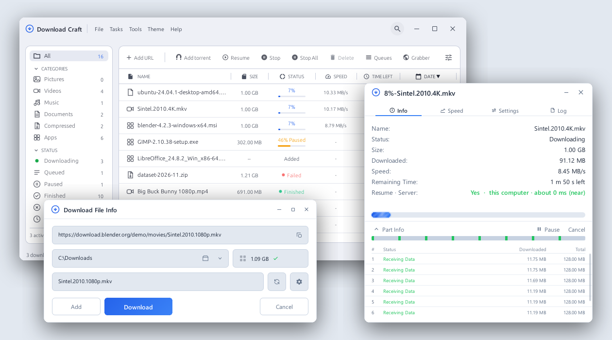</picture>

</div>

## 💡 Why switch to Download Craft

<p align="center"><picture><source media="(prefers-color-scheme: dark)" srcset="docs/images/why-dark.svg">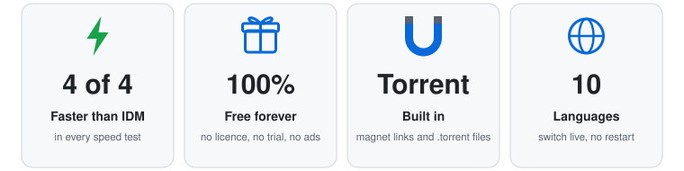</picture></p>

<p align="center"><picture><source media="(prefers-color-scheme: dark)" srcset="docs/images/race-dark.svg">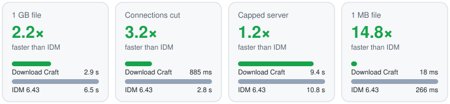</picture><br>
<sub>Same PC and local test server, 8 connections each. <a href="#speed-measured">How we measured</a></sub></p>

|  | Download Craft | IDM 6.43 |
|---|---|---|
| Price | **Free forever** (MIT licence) | Paid licence after a trial |
| Torrents | **Built in**: magnet links and .torrent files, sharing up to a ratio you set | Not included |
| YouTube and 1,000+ sites | **Built in**, with its own yt-dlp kept up to date | Needs the browser extension |
| HLS / DASH streams, live recording | **Yes**, with size and time left | Through its browser extension |
| Browser extension works without the app | **Yes** | No |
| Languages | **10**, switched live | Many |
| Windows, macOS and Linux | **All three** | Windows only |
| Source code | **Open** | Closed |

---

## 🎬 See it in 90 seconds

https://github.com/user-attachments/assets/acd6afd0-926c-4e11-a718-3edf42c4f7c6

---

## ✨ What's new in 0.10.0

- **Bangla interface:** every window, menu and message in natural Bangla, switched live
  (Settings → Appearance → Language).
- **YouTube:** live streams record until you press Stop; HDR and 8K in the quality menu;
  saved videos keep their cover, chapters and title.
- **Options window for the Classic layout:** the tabs and pages of a classic download
  manager's Options dialog, with per-server connections, duplicate-link handling, queue
  selection, server file dates, download limits, FTP through a proxy and more.
- **Find a setting**, **stream sizes and time left** for HLS/DASH, **drag to reorder the
  queue**, and **failed downloads that say what to do next** (with Retry on the notification).
- **AMOLED black theme**, a new tray menu, and security fixes.

Full notes: [Release 0.10.0](https://github.com/hungry-detective/downloadcraft/releases/tag/v0.10.0).

---

## 📸 Screenshots

Three layouts, each in dark and light (GitHub shows the one that matches your theme). Pick one in
**Theme → Layout**.

<table>
  <tr>
    <td width="50%" valign="top"><picture><source media="(prefers-color-scheme: dark)" srcset="docs/images/screens/main-craft-dark.png">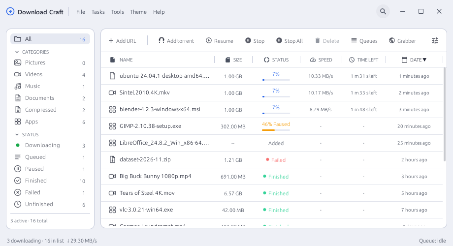</picture><p align="center"><b>Craft</b>: the app's own layout</p></td>
    <td width="50%" valign="top"><picture><source media="(prefers-color-scheme: dark)" srcset="docs/images/screens/main-classic-dark.png">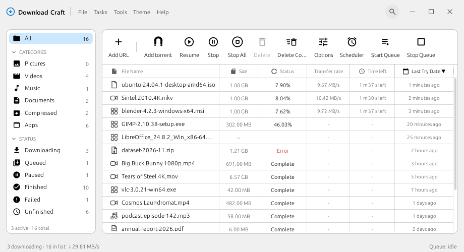</picture><p align="center"><b>Classic</b>: a classic download manager's toolbar and sidebar</p></td>
  </tr>
  <tr>
    <td width="50%" valign="top"><picture><source media="(prefers-color-scheme: dark)" srcset="docs/images/screens/main-petal-dark.png">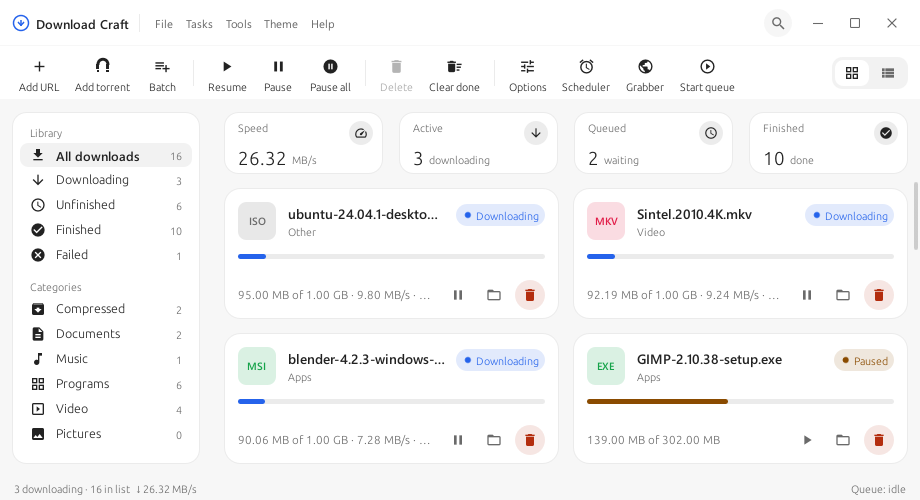</picture><p align="center"><b>Petal</b>: summary tiles and downloads as cards</p></td>
    <td width="50%" valign="top"><picture><source media="(prefers-color-scheme: dark)" srcset="docs/images/screens/fileinfo-craft-dark.png">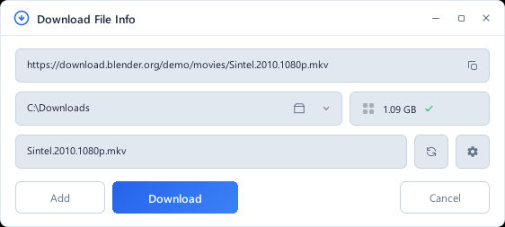</picture><p align="center"><b>Download File Info</b>: the real name and size before it starts</p></td>
  </tr>
  <tr>
    <td width="50%" valign="top"><picture><source media="(prefers-color-scheme: dark)" srcset="docs/images/screens/progress-craft-dark.png">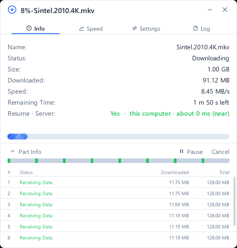</picture><p align="center"><b>Progress</b>: speed, time left and every connection</p></td>
    <td width="50%" valign="top"><picture><source media="(prefers-color-scheme: dark)" srcset="docs/images/screens/settings-classic-dark.png">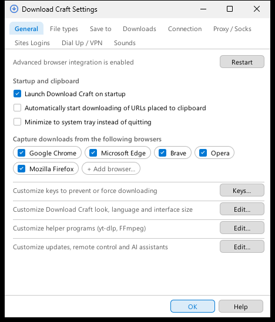</picture><p align="center"><b>Options</b>: the Classic layout's compact settings</p></td>
  </tr>
</table>

<table>
  <tr>
    <td width="50%" valign="top">
      
      <p><b>Extension popup</b> — every video on the page, with the app or in the browser alone.</p>
    </td>
    <td width="50%" valign="top">
      
      <p><b>Downloads tab</b> — browser downloads and the app's queue, side by side.</p>
    </td>
  </tr>
</table>

<p align="center">
  <picture><source media="(prefers-color-scheme: dark)" srcset="docs/images/extension-small-button-dark.png">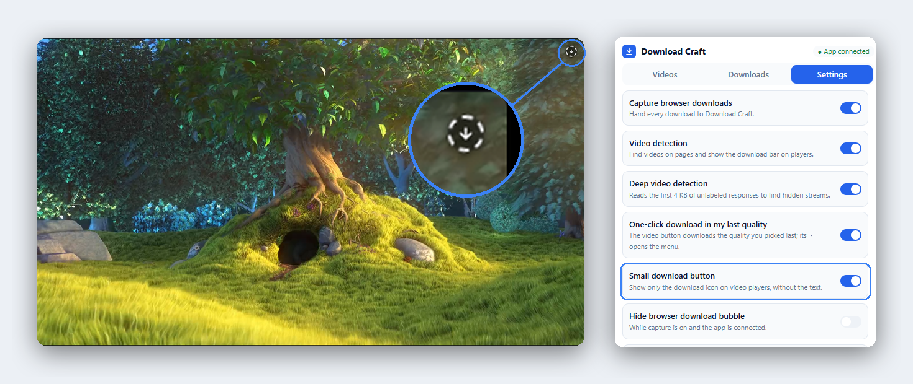</picture><br>
  <b>On every player</b>: a download button in the corner. Switch on <b>Small download button</b> in the
  extension's Settings and it is just this round icon.
</p>

---

## 🚀 Features

**Downloading**
- **Dynamic segmentation** (1–32 connections): a free connection takes over half of whatever would finish
  last, so no connection idles while another crawls. Crash-safe resume, self-healing connections and
  automatic link refresh. See [the engine](#-the-engine).
- A global speed limit, per-download connections and a per-server connection cap.
- Queue with concurrency limit, scheduler, retry-all-failed and finish actions (shutdown / sleep / hibernate).
- Smart names from the server or the video title; safe auto-rename or overwrite; optional SHA-256 check.
- HLS and DASH streams (live recording, AES-128), video + audio merged with FFmpeg.

**Video sites**
- YouTube and 1,000+ sites through the app's own **yt-dlp**, kept up to date automatically — 1080p, 4K
  and merged audio + video. A portable JavaScript runtime installs in one click.
- Facebook / Instagram reels, Vimeo, Bilibili and generic players detected from the page itself.

**Browser extension (Chrome, Edge, Brave, Firefox)**
- Catches videos from network traffic, manifests and page data — HLS, DASH, MP4/WebM, subtitles.
- *Download this video* bar on players, quality menus with sizes, right-click *Download all links*.
- Works **without the app**: downloads, joins and saves videos in the browser.
- **IDM-style hand-off.** A browser download is *paused*, handed to the app, and resumed in the browser
  if the app can't take it, so nothing is lost. Form (POST) downloads, the browser's own request headers,
  its proxy and the server it used all go along. Hold **Alt** while clicking to keep a download in the
  browser.
- **A live connection to the app.** Capture settings (file types, excluded sites, minimum size) are
  edited in the app and pushed to the browser, with notifications when downloads finish. Site rules
  update from the project without a new extension release.
- **Safety net.** YouTube runs the app's own engine or yt-dlp first (your choice in Settings), and the
  other one takes over if it fails. A file the server refuses to the app is fetched inside the open
  page instead. A video the app can't get is downloaded in the browser.

**App**
- System / Dark / Light themes, status sidebar, search, sortable and resizable columns, bulk actions.
- File names in any script (Bangla, Arabic, CJK …) with proper Indic shaping.
- Clipboard detection, notifications, tray icon, antivirus hook, and a CLI that shares the same queue.

---

## ⚡ The engine

The download engine is a separate, reusable Rust crate,
[`crates/downloadcraft-engine`](crates/downloadcraft-engine). Use it to make your own downloader fast
too (MIT).

- **Work stealing.** When a connection finishes, it splits the part that will finish last, in
  proportion to the measured speeds. A slow connection never holds the whole download back, and very
  slow ones are reopened.
- **The first request is the probe.** Downloading starts at once; more connections join as soon as the
  server shows it supports ranges.
- **One pre-allocated file.** There is no joining of parts at the end, so bytes are not copied a second
  time.
- **Crash-safe resume.** A journal of the missing ranges is flushed every few seconds. A changed server
  file (size, ETag, Last-Modified) is detected instead of being stitched onto old bytes.
- **Self-healing.** HTTP 429/503 lowers the connection count, a per-IP connection limit is detected,
  and cut or stalled connections resume where they stopped.
- **Expired links.** A refused signed link is retried through its original URL, or re-resolved from
  its page, keeping every byte already downloaded.
- **Checks every reply.** A wrong `Content-Range`, a different size, or an HTML error page instead of
  the file is caught before it can corrupt the download.
- **ZIP preview.** `download_craft peek <url>` lists what's inside a remote ZIP without downloading it.

Measured on a home connection (100 MB, 8 connections) against 0.9.8: speedtest.belwue.net went from
70.6 s to **21.4 s**, and mirror.nforce.com from 28.2 s to **19.7 s**.

```rust
let done = downloadcraft_engine::Downloader::new(reqwest::Client::new())
    .download(Job::new(url, "file.iso"), progress, control)
    .await?;
```

---

<a id="speed-measured"></a>

## ⏱️ Speed, measured

<p align="center">
  <picture>
    <source media="(prefers-color-scheme: dark)" srcset="docs/images/bench-dark.svg">
    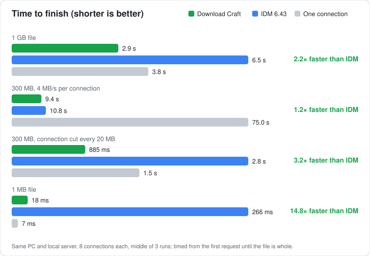
  </picture>
</p>

Download Craft, IDM 6.43 build 18 and a one-connection download (what a browser does), on the
same PC and the same local test server, with the same files. Both download managers used 8
connections. Every program is timed the same way: from the first request it sends to the server
until the whole file is in place and the program has let go of it. Each test ran three times and
the chart shows the middle run. Every file up to 300 MB was checked byte for byte against the
original, and the 1 GB file by its size.

| Test | Download Craft | IDM 6.43 | |
|---|---|---|---|
| 1 GB file | **2.9 s** | 6.5 s | **2.2× faster** |
| 300 MB, each connection capped at 4 MB/s | **9.4 s** | 10.8 s | **1.2× faster** |
| 300 MB, connections cut every 20 MB | **0.89 s** | 2.8 s | **3.2× faster** |
| 1 MB file | **18 ms** | 266 ms | **15× faster** |

IDM was handed each download from Chrome through its extension, and our script pressed its
Start Download button the moment its window opened, so IDM's times include that window (a
person would take longer). Download Craft ran from its command line (`download_craft get`).

A local server shows what each program does, not your internet speed. On a real connection the
gain depends on the server. The test scripts and these results are in [`tools/bench`](tools/bench),
so you can run it yourself.

## 🛠️ Built our own way

Download Craft is not a copy of Internet Download Manager and was not reverse-engineered from it.
We used IDM, liked how it works, and built the same ideas again from scratch, our own
way, in Rust. It contains no IDM code.

---

## 📦 Install

| Platform | Download | How |
|---|---|---|
| **Windows 10/11** | `DownloadCraft-0.10.0-windows-x64-setup.exe` or `DownloadCraft-0.10.0-windows-x64-portable.zip` | Run the installer (no administrator rights), or extract the zip and run `download_craft.exe`. |
| **macOS 12+** | `DownloadCraft-0.10.0-macos-Universal.zip` | Move *Download Craft.app* to Applications (development build, not notarized — right-click → Open the first time). |
| **Ubuntu / Debian / Mint** | `downloadcraft_0.10.0_amd64.deb` | `sudo apt install ./downloadcraft_0.10.0_amd64.deb` |
| **Fedora** | `downloadcraft-0.10.0-1.x86_64.rpm` | `sudo dnf install ./downloadcraft-0.10.0-1.x86_64.rpm` |
| **Other Linux** | `DownloadCraft-0.10.0-x86_64.AppImage` | Make it executable and open it. |

**Browser extension**
1. **Chrome / Edge / Brave:** extract `DownloadCraft-Chrome-0.10.0.zip`, open `chrome://extensions`, turn on
   *Developer mode*, choose **Load unpacked** and pick the `browser-extension` folder.
2. **Firefox:** open `about:debugging#/runtime/this-firefox` → **Load Temporary Add-on…** → pick
   `DownloadCraft-Firefox-0.10.0.xpi`.
3. In the app, open **Settings → Browser Integration** and press **Install** for your browser, so the
   extension can talk to the app. (Without it, the extension still downloads in the browser.)

Your queue and settings live in `%APPDATA%\download_craft` (Windows) and carry over between versions.

---

## 🛠️ Build from source

Prerequisites: [Rust stable](https://www.rust-lang.org/tools/install) (MSVC build tools on Windows).

```powershell
cargo build --release   # target\release\download_craft.exe (portable)
cargo test --workspace  # app + engine crate: unit and local HTTP tests (no network needed)
node --test browser-extension/*.test.js   # extension tests
```

Packaging: `python scripts/package.py --platform windows --arch x64` (see [PORTABLE-BUILDS.md](PORTABLE-BUILDS.md)
for macOS and Linux).

**Command line:** `download_craft.exe add "https://example.com/file.zip"`,
`download_craft.exe get "https://example.com/file.zip" -o out.zip`,
`download_craft.exe peek "https://example.com/file.zip"`, `download_craft.exe --help`.

---

## 📄 License

MIT — free for open-source, closed-source and commercial use. See [`LICENSE`](LICENSE);
[`NOTICE.md`](NOTICE.md) lists the bundled third-party assets (Material Icons, fonts).

<div align="center"><sub>Screenshots use Blender Foundation open movies (CC BY) and public test streams.</sub></div>
